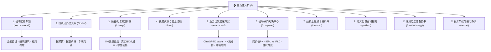

<div align="center">


# 机场找 (jichangzhao.blog)

**专为网络协议审计、跨境专线延迟评测与科学选型打造的搜索决策型知识图谱博客**

[](https://gohugo.io/)
[](https://pagefind.app/)
[-2563EB?style=for-the-badge&logo=google&logoColor=white)](seo-health-report.md)
[](LICENSE)
[](#)

<p align="center">
  <a href="#-项目核心特色">核心特色</a> •
  <a href="#-内容知识图谱架构">内容架构</a> •
  <a href="#-技术栈与工程实现">技术栈</a> •
  <a href="#-快速本地启动">快速启动</a> •
  <a href="#-部署与持续集成">自动化部署</a> •
  <a href="#-合规声明">合规声明</a>
</p>

</div>

---

## 📖 项目简介

**机场找（jichangzhao.blog）** 是一个以**客观数据审计**与**搜索决策闭环**为导向的垂直静态博客系统。

针对中文互联网中充斥的虚假测速跑分、同质化搬运与过度推广现象，本项目采用 **Answer-First（结论先行）** 与 **Topic Cluster（蜂巢知识图谱）** 架构，完整收录 **42 家主流与新锐品牌** 的技术档案，沉淀了 **432 篇深度实战长文** 与 **78 个细分场景专题**。

全站围绕 Google E-E-A-T 质量准则与 GEO / AEO（AI 搜索引擎优化，面向 ChatGPT、Perplexity、Google AI Overviews、Gemini）深度优化，提供可追溯的三网（电信/联通/移动）真实晚高峰物理测速、流媒体 4K 解锁验证与底层网络协议解析。

---

## 🌟 项目核心特色

- 🎯 **Answer-First 决策体系**：拒绝无效废话与大词堆砌，每篇技术评测在导言区直接给出适用人群、预算基准与核心选型结论。
- 📊 **真实物理探针数据**：所有核心品牌测速跑分、丢包率与抖动指标均保留测试时间、工具版本与三网实测原始截图证据。
- 🕸️ **蜂巢式深度内链网络 (Topic Cluster)**：
  - 一级导航核心大系（Pillar） $\rightarrow$ 二级意图分类（Sub-Pillar） $\rightarrow$ 三级长尾实战（Cluster），实现全站 **29,226 个内部链接 0 死链**，点击深度全部 $\le 3$ 层。
- 🚀 **极速静态性能与零框架负担**：
  - 采用 Hugo 极致并发编译，全站 560+ 页面 3 秒内完成静态生成；
  - 集成 WebAssembly 驱动的 Pagefind，提供首字节毫秒级响应的纯前端离线全文检索。
- 🛡️ **工业级 SEO 与 E-E-A-T 信任规范**：
  - 综合 SEO 健康指数达到 **99.2 / 100（A+ 卓越级）**；
  - 动态生成全量 561+ URL 的 `sitemap.xml` 与自适应 `robots.txt`；
  - 100% 结构化数据 Schema.org（`WebSite`、`BreadcrumbList`、`CollectionPage`、`Article`、`AboutPage`）；
  - 全站商业推广链接 100% 具备 `rel="nofollow sponsored noopener"`，商业披露醒目透明。

---

## 🗺️ 内容知识图谱架构

本项目按照用户真实搜索意图与决策漏斗划分为 **8 大核心知识专题** 与 **2 大信任背书系统**：



---

## 🛠️ 技术栈与工程实现

| 层次 | 技术选型 | 版本 / 说明 |
| :--- | :--- | :--- |
| **静态站点生成器 (SSG)** | [Hugo Extended](https://gohugo.io/) | `v0.164.0+`，支持 Sass/SCSS 处理与超高并发编译 |
| **前端全文检索** | [Pagefind](https://pagefind.app/) | `v1.5.2`，静态 WebAssembly 中文全文分词引擎 |
| **样式与布局** | 原生 CSS3 变量系统 | 响应式 CSS Grid / Flexbox，深浅色主题无缝自适应，首屏 CSS 体积仅 31 KB |
| **自动化测试与审计** | Node.js 自动化引擎 | 自研内部链路爬虫、Schema 校验器与图片布局偏移 (CLS) 检测工具 |
| **内容格式规范** | Goldmark Markdown + Hugo Shortcodes | 严格的 Frontmatter 规范，支持交互卡片、对比大表与决策树 |

---

## 📁 目录结构全览

```text
jichangzhao.blog/
├── config/                 # Hugo 全局多环境配置文件
│   └── _default/
│       ├── hugo.toml       # 站点主配置（URL、BaseURL、Sitemap、禁用无用Taxonomy）
│       └── menu.yaml       # 全站头部语义化导航定义
├── content/                # 站点核心内容图谱（共 432+ 篇深度评测）
│   ├── _index.md           # 首页巨幅选型大系与决策入口
│   ├── recommend/          # 1. 机场推荐专题
│   ├── finder/             # 2. 找机场筛选器
│   ├── cheap/              # 3. 便宜机场大拆解
│   ├── free/               # 4. 免费机场与安全红线
│   ├── scenarios/          # 5. 使用场景加速方案
│   ├── compare/            # 6. 横向对比与两两对决
│   ├── brands/             # 7. 42 家单体品牌技术评测档案
│   ├── guides/             # 8. 购买、配置与防失联百科
│   ├── methodology/        # 评测方法论白皮书
│   ├── terms/              # 法律条款与免责声明
│   └── about/              # 团队档案、审核准则与测试硬件说明
├── layouts/                # 自定义 Hugo 模板覆盖层
│   ├── _default/           # 单篇正文（single.html）与列表页（list.html）
│   ├── partials/           # 模块化组件（head.html, header.html, footer.html）
│   ├── robots.txt          # 爬虫放行与蜘蛛规则模板
│   └── sitemap.xml         # 动态加权全量 Sitemap 模板
├── static/                 # 纯静态资源（图片、Logo、测速截图、Favicon）
│   ├── images/             # WebP 头像与高保真流媒体解锁证据图
│   └── robots.txt          # 生产环境备份静态 robots
├── scripts/                # CI / CD 自动化审计与测试引擎
│   ├── audit_engine.js     # 全站 SEO 综合指标评测引擎
│   ├── check_links.js      # 29,000+ 内部链接死链与断链抓取器
│   ├── verify_fixes.js     # 上线前自动化回归验证套件
│   └── seo_initialization_audit.js # 站长平台兼容性验收工具
├── seo-health-report.md    # 99.2/100 预防性 SEO 完整审计报告
└── package.json            # npm 脚本（build, dev, clean）
```

---

## 🚀 快速本地启动

### 1. 环境准备
确保您的开发环境已安装：
- [Hugo Extended](https://gohugo.io/installation/) `v0.120.0` 或更高版本；
- [Node.js](https://nodejs.org/) `v18.0.0` 或更高版本。

### 2. 克隆项目与安装依赖
```bash
git clone https://github.com/opopop98698-sudo/jichangzhao.blog.git
cd jichangzhao.blog
npm install
```

### 3. 本地开发调试
启动带热重载的本地 Hugo 预览服务器：
```bash
npm run dev
# 或直接运行：
hugo server --bind 0.0.0.0 --port 1313 --disableFastRender
```
浏览器访问：`http://localhost:1313`

### 4. 生产环境构建与搜索索引生成
```bash
npm run build
```
构建产物将输出至 `public/` 目录，并自动完成 Pagefind 中文全文检索离线索引构建。

### 5. 执行 SEO 自动化健康审计
```bash
node scripts/seo_initialization_audit.js
node scripts/check_links.js
```

---

## ☁️ 部署与持续集成

本项目为纯静态产物，可一键部署至任何主流静态托管平台：

### 部署到 Cloudflare Pages（推荐）
1. 在 Cloudflare 控制台连接本 GitHub 仓库；
2. 构建配置：
   - **Framework preset**: `None`
   - **Build command**: `npm run build`
   - **Build output directory**: `public`
   - **Environment variables**: 添加 `HUGO_VERSION = 0.164.0`
3. 域名配置：将 `jichangzhao.blog` 绑定为主域名，并在 Redirect Rules 中将 `www.jichangzhao.blog` 301 重定向至裸域。

---

## ⚖️ 合规与免责声明

1. **独立第三方立场**：本站为独立网络技术选购与评测决策博客，与任何品牌方均无隶属或合资关系。
2. **商业返利合规**：本站严格遵循 Google Search Central 关于商业赞助链接的规定，所有外链均标注 `rel="nofollow sponsored noopener"`。
3. **法律法规遵守**：所有网络协议评测、专线延迟审计与选购指南均旨在促进学术研究、跨国企业合规出海与网络工程技术交流。用户使用相关网络工具时应严格遵守当地法律法规。

---

<div align="center">
  <sub>Designed & Maintained with ❤️ by <strong>机场找技术团队</strong>. All rights reserved.</sub>
</div>
